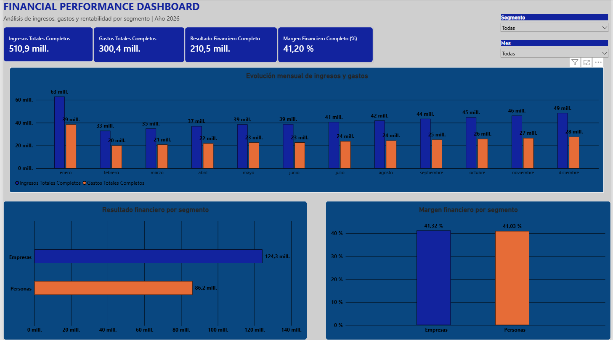

# Financial Performance Dashboard

## Descripción del proyecto

Dashboard financiero desarrollado en Power BI Desktop para analizar ingresos, gastos y rentabilidad de una entidad bancaria ficticia durante el año 2026.

El proyecto permite evaluar el desempeño financiero mensual y comparar los resultados entre los segmentos Personas y Empresas.

## Objetivos

- Analizar la evolución mensual de ingresos y gastos.
- Evaluar el resultado financiero.
- Comparar la rentabilidad entre segmentos.
- Identificar tendencias mediante indicadores y gráficos interactivos.

## Herramientas utilizadas

- Power BI Desktop
- Power Query
- DAX
- Microsoft Excel (preparación de datos)

## Indicadores principales

| Indicador | Resultado |
|---|---:|
| Ingresos totales | $510,9 millones |
| Gastos totales | $300,4 millones |
| Resultado financiero | $210,5 millones |
| Margen financiero | 41,20 % |

## Análisis realizado

- Evolución mensual de ingresos y gastos.
- Resultado financiero por segmento.
- Margen financiero por segmento.
- Filtros interactivos por mes y segmento.

## Datos

- Período: enero a diciembre de 2026.
- Registros: 26.
- Segmentos: Personas y Empresas.
- Datos ficticios creados con fines educativos y de portfolio.

## Autor

Proyecto desarrollado como parte de mi portfolio profesional orientado a posiciones de Analista de Datos Junior.

## Dashboard

